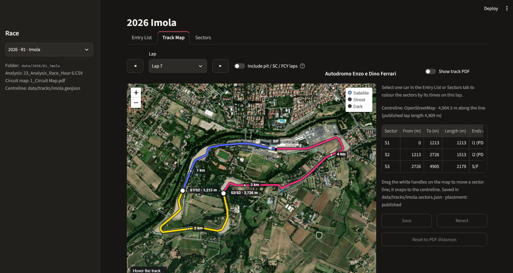
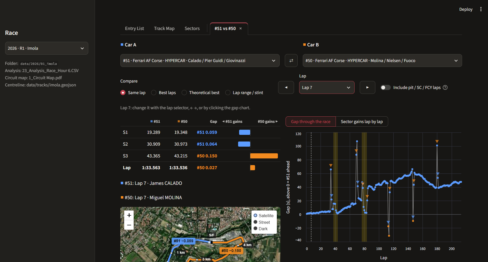

# WEC Dashboard

An interactive dashboard for analysing FIA World Endurance Championship races, built with Streamlit on top of the official Al Kamel timing data.

Pick a race, and you can explore the entry list, see the circuit on a satellite map split into its timing sectors, compare sector times lap by lap, and run head-to-head comparisons between any two cars.



## Features

**Entry List**
- Every car grouped by class, with team, manufacturer, drivers, laps completed and best lap.
- Select cars here to open a head-to-head.

**Track Map**
- The circuit centreline on a satellite basemap (Leaflet), split into S1 / S2 / S3.
- Sector boundaries can be dragged on the map and saved per circuit.
- The official FIA circuit map is shown alongside as a reference.

**Sectors**
- Sector and lap times for every car on a selected lap.
- **Purple** = fastest in class on that lap, **green** = the car's personal best so far.
- Pit in/out, Safety Car and FCY laps are greyed out and left out of the purple/green calculation (toggleable).
- Cars more than 10 laps behind their class leader get a **+N L** badge, because their "lap N" happened at a very different time from the rest of the field.
- Sort by any column, filter by class, and click a row to colour that car's sectors on the map.

**Head-to-head** (one tab per comparison, as many as you like)
- Four comparison modes: same lap, best laps, theoretical best (best S1 + S2 + S3), and lap range / stint averages.
- Sector-by-sector delta breakdown, with the map coloured by which car was faster in each sector.
- **Gap chart**: the gap between the two cars at the end of every lap, with pit stops and SC/FCY periods marked. Click a point to jump to that lap.
- **Trend chart**: S1 / S2 / S3 deltas lap by lap, to see where one car consistently gains time.

Open tabs and the active tab are saved in the URL, so a refresh or a shared link restores the same view.



## A note on the data

Al Kamel publishes **timing data only**: lap times, sector times, speeds, pit stops and flag status for every car on every lap. There is no GPS or telemetry, so the dashboard can't show the actual racing line a driver took. Everything on the map is based on the track centreline and the sector boundaries.

## Getting started

Requires Python 3.11+ (developed on 3.13).

```bash
git clone https://github.com/kennedyromick/wec-dashboard.git
cd wec-dashboard

python -m venv .venv
# Windows (PowerShell)
.venv\Scripts\Activate.ps1
# macOS / Linux
source .venv/bin/activate

pip install -r requirements.txt
streamlit run app.py
```

The dashboard opens in your browser at `http://localhost:8501`.

## Race data

The repo includes the 2026 season races in `data/2026/`. To add a race:

1. Go to [fiawec.alkamelsystems.com](https://fiawec.alkamelsystems.com/), open the race session and download the **Analysis** CSV (e.g. `23_Analysis_Race_Hour 6.CSV`) and the **Circuit Map** PDF.
2. Put both in a folder named `data/<season>/<NN>_<circuit>/`, e.g. `data/2026/01_imola/`.
3. Make sure the circuit has a centreline in `data/tracks/<circuit>.geojson` (see below).

The dashboard lists every race folder that contains an Analysis file. See [`data/README.md`](data/README.md) for the full folder rules.

## Track centrelines and sectors

Each circuit needs two files in `data/tracks/`:

| File | What it is |
|---|---|
| `<circuit>.geojson` | The circuit centreline as a closed loop |
| `<circuit>.sectors.json` | Where the S1/S2 and S2/S3 boundaries sit along the lap |

To fetch a new centreline from OpenStreetMap you need Node.js:

```bash
npm install
npm run fetch-track -- <circuit>
```

Then open the Track Map tab, drag the sector boundaries into place against the official circuit map, and save.

There is also `npm run inspect`, which prints a summary of any Analysis CSV in `data/` (cars per class, laps per car, fastest laps, rows that failed to parse).

## Project structure

```
app.py               Streamlit entry point: race picker, tabs, layout
wec/
  parsing.py         Reads Al Kamel CSVs (car numbers kept as strings: #007 ≠ #7)
  laps.py            Per-lap data: sector times, pit flags, SC/FCY tagging, laps down
  races.py           Finds race folders under data/
  track.py           Loads centrelines and computes distance along the lap
  sectors.py         Sector boundary config
  track_map.py/.js   Leaflet map component
  entry_list.py      Entry List tab
  sector_table.py    Sectors tab
  head_to_head.py    Comparison logic (modes, deltas)
  h2h_view.py        Head-to-head tab and charts
  tab_bar.py         Tab bar with closable head-to-head tabs
  config.py          Settings, e.g. the laps-down threshold
scripts/             Node helper scripts (fetch-track, inspect)
data/                Race data and track files
```

## To-do

- [ ] **Practice and qualifying sessions**: load the Free Practice, Qualifying and Hyperpole Analysis files alongside the race, with a session picker for each event.
- [ ] **Other seasons**: add earlier (and future) WEC seasons under `data/<season>/`, with a season picker.
- [ ] **Racing line comparison in head-to-head**: overlay the line each car took through a sector using GPS data. Al Kamel doesn't publish GPS, so this needs another source, such as telemetry exported from Le Mans Ultimate.

## Built with

Python · Streamlit · pandas · Altair · Leaflet · PyMuPDF

## Credits

- Timing data and circuit maps © FIA WEC / Al Kamel Systems, from [fiawec.alkamelsystems.com](https://fiawec.alkamelsystems.com/). This is an independent project, not affiliated with the FIA, WEC or Al Kamel.
- Circuit centrelines © [OpenStreetMap](https://www.openstreetmap.org/copyright) contributors, available under the ODbL.
- Satellite imagery © Esri.
